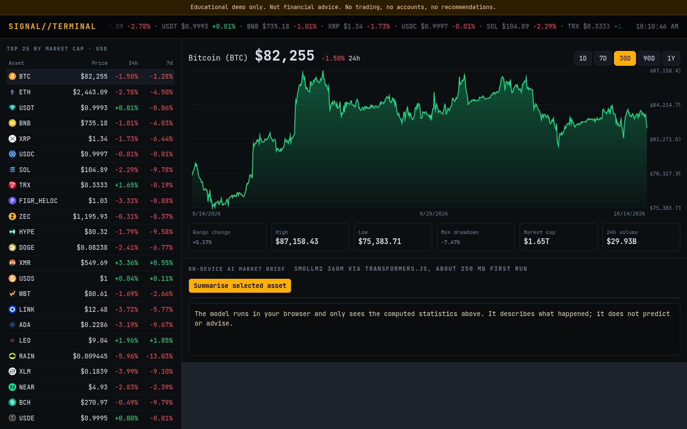

# Signal Terminal

A terminal-style crypto market dashboard using the free CoinGecko public API, with price charts, risk statistics and plain-language briefs written by a small LLM running on your device.

**Live:** https://josephbepocode.github.io/ai-markets-terminal/

## Features
- Top 25 assets with 24h and 7d change, scrolling ticker
- Canvas price chart with 1D to 1Y ranges
- Stats: range change, high, low, max drawdown, market cap, volume
- SmolLM2 360M summaries from computed statistics only

## Notes
Educational demo. **Not financial advice.** No trading, no accounts, no recommendations. Data may be rate limited by CoinGecko.

## Run locally
It is a static site. Serve the folder with any static server, for example `python3 -m http.server`, and open `http://localhost:8000`.

No backend, no API keys. Built by Deji.
